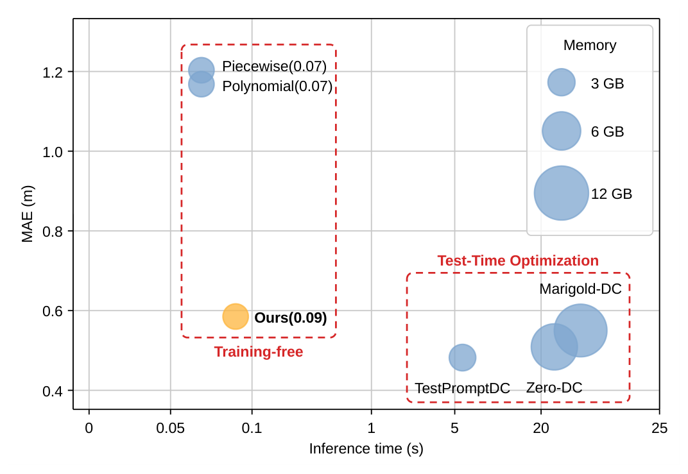

<div align="center">
<h1 style="border-bottom: none; margin-bottom: 0px">FoSA: Fast Video Depth Completion via Fourier Scale-and-Shift Alignment</h1>

[**Myungjun Yun**](https://github.com/YUNMYUNGJUN) · [**Jin-Hwi Park**](https://www.csilab.cau.ac.kr/home)<sup>&dagger;</sup>

[CSILab](https://www.csilab.cau.ac.kr/home) · [GSAIM](https://gsaim.cau.ac.kr),  [Chung-Ang University](https://www.cau.ac.kr)

&dagger;Corresponding author


<a href="docs/METHOD.md"></a>
<a href="docs/RESULTS.md"></a>
<a href="LICENSE"></a>

</div>

This work presents **FoSA**, a training-free method that turns the prediction of a frozen depth
foundation model into accurate, temporally stable metric video depth using sparse range
measurements. Each frame is aligned by one closed-form linear solve, with no backpropagation:

- 〰️ **Fourier scale-and-shift fields** replace the global affine fit, so the correction can vary across the image.
- 📡 **Density-aware damping** attenuates each frequency by the local spacing of the measurements, so the degrees of freedom follow their Nyquist limit without manual tuning.
- 🎞️ **Residual Temporal Gradient Matching (R-TGM)** regularizes the correction residual over time, keeping the backbone's own temporal behavior without optical flow or camera pose.

🏆 With a UniDepth V2 backbone, FoSA reduces the MAE of the least-squares fit by 27–59% on NYUv2,
KITTI-DC, DDAD, and DyDToF. It also outperforms test-time adaptation methods on DDAD and DyDToF while
running 60–240× faster than them (0.09 s per frame, backbone included).

<p align="center">
  
</p>
<p align="center">
  
</p>

## 📰 News

- **05-11-2026:** 🚀 Project page and foundation-model setup released. Code coming soon.

## 🧩 Supported Foundation Models

FoSA aligns the output of a frozen foundation model, so the same alignment runs on single-image and
video backbones.

| 🗃️ Foundation model | 🎞️ Input | 📐 FoSA fits in | 🐍 conda env | 🔗 Official code |
| :--- | :---: | :---: | :---: | :--- |
| UniDepth V2 | Single image | Depth | `fosa-unidepth` | [lpiccinelli-eth/UniDepth](https://github.com/lpiccinelli-eth/UniDepth) |
| Video Depth Anything | Video | Inverse depth | `fosa-vda` | [DepthAnything/Video-Depth-Anything](https://github.com/DepthAnything/Video-Depth-Anything) |
| DVD | Video | Inverse depth | `fosa-dvd` | [EnVision-Research/DVD](https://github.com/EnVision-Research/DVD) |
| Depth Anything 3 | Single image | Inverse depth | `fosa-da3` | [ByteDance-Seed/Depth-Anything-3](https://github.com/ByteDance-Seed/Depth-Anything-3) |

## 🚀 Quick Start

### 📦 Setup

Each foundation model requires its own conda environment due to dependency conflicts (torch,
xformers, and CUDA builds differ). Install [Anaconda or Miniconda](https://docs.anaconda.com/miniconda/) first.

```bash
git clone https://github.com/YUNMYUNGJUN/FoSA.git
cd FoSA

bash scripts/setup_env.sh all         # set up all four foundation models
# Or set up individual foundation models
# bash scripts/setup_env.sh unidepth  # set up UniDepth V2 env
# bash scripts/setup_env.sh vda       # set up Video Depth Anything env
# bash scripts/setup_env.sh dvd       # set up DVD env
# bash scripts/setup_env.sh da3       # set up Depth Anything 3 env
```

Each command does the following:

1. Clones the model's official repository into `third_party/` at a pinned commit.
2. Creates a conda environment.
3. Installs the model following its official instructions.
4. Downloads the checkpoints that are not fetched automatically (Video Depth Anything, DVD).
   UniDepth V2 and Depth Anything 3 load their weights from Hugging Face on first use.

After setup, activate the corresponding environment:

```bash
conda activate fosa-unidepth  # for UniDepth V2
conda activate fosa-vda       # for Video Depth Anything
conda activate fosa-dvd       # for DVD
conda activate fosa-da3       # for Depth Anything 3
```

### 💻 Usage

Coming with the code release.

<!--
TODO(server): Replace with the real commands in the CAPA style: one bash block with a comment per
command (e.g., align a single clip, process a directory, evaluate RMSE/MAE/TEPE), each run inside
one of the conda environments above. Every command must actually run against this repository.
-->

## 📊 Results

UniDepth V2 backbone for every sparse depth alignment method. **TTA**: test-time adaptation of the
backbone. **Align**: sparse depth alignment of a frozen backbone's output. Metrics are in meters,
and **bold** marks the best value in each column.

| Method | Type | NYUv2 RMSE | NYUv2 MAE | KITTI-DC RMSE | KITTI-DC MAE | DDAD RMSE | DDAD MAE | DyDToF RMSE | DyDToF MAE |
| :--- | :--- | :---: | :---: | :---: | :---: | :---: | :---: | :---: | :---: |
| Zero-DC | TTA | 0.152 | 0.097 | 1.515 | 0.509 | 7.163 | 3.621 | 3.399 | 2.038 |
| Marigold-DC | TTA | 0.135 | **0.053** | 1.483 | 0.550 | 6.401 | 2.708 | 2.662 | 1.094 |
| TestPromptDC | TTA | **0.128** | 0.054 | **1.480** | **0.482** | 5.652 | 1.963 | 2.311 | 0.927 |
| LS Solver | Align | 0.175 | 0.088 | 2.321 | 1.227 | 6.316 | 3.683 | 2.638 | 1.707 |
| Polynomial | Align | 0.169 | 0.084 | 2.255 | 1.168 | 5.183 | 2.672 | 2.337 | 1.306 |
| Piecewise | Align | 0.172 | 0.086 | 2.314 | 1.203 | 5.792 | 3.111 | 2.466 | 1.438 |
| **FoSA (Ours)** | Align | 0.148 | 0.064 | 1.749 | 0.585 | **4.551** | **1.527** | **1.854** | **0.798** |

<p align="center">
  
</p>

For the other backbones (VDA, DVD, DAv3), temporal consistency (TEPE), sparser measurements,
ablation, efficiency, and qualitative results, see [docs/RESULTS.md](docs/RESULTS.md).

## 📚 Useful Documentation

- 🧮 [Method](docs/METHOD.md): the alignment, equation by equation
- 📊 [Results](docs/RESULTS.md): all tables and figures of the paper

## 📄 License

### FoSA Source Code

Copyright © 2026 YUNMYUNGJUN.

The FoSA source code (all files in this repository) is released under the
[MIT License](LICENSE).

### Third-Party Components

`scripts/setup_env.sh` downloads the official code of each foundation model into `third_party/`.
That directory is not tracked by this repository. Each component is governed exclusively by its own
license, and the MIT License above does **not** apply to it.

| Component | Directory | License | Source |
| --- | --- | --- | --- |
| UniDepth V2 | `third_party/UniDepth/` | CC BY-NC 4.0 | [8d8cfe4](https://github.com/lpiccinelli-eth/UniDepth/tree/8d8cfe4c7ee15297099983607febf0d4f32eb3d6) |
| Video Depth Anything | `third_party/Video-Depth-Anything/` | Apache 2.0 | [4f5ae23](https://github.com/DepthAnything/Video-Depth-Anything/tree/4f5ae23172ba60fd7bc11ef671cca678842c7072) |
| DVD | `third_party/DVD/` | Apache 2.0 | [62f52d1](https://github.com/EnVision-Research/DVD/tree/62f52d16faa2cac10e31eb7815ece6e61d5449ec) |
| Depth Anything 3 | `third_party/Depth-Anything-3/` | Apache 2.0 | [3d835ec](https://github.com/ByteDance-Seed/Depth-Anything-3/tree/3d835ec1a5802d64a8b8b15f817a1ab54809bfe4) |

Model weights are subject to the licenses stated by their authors and can differ from the code
license. For example, the Video Depth Anything Base/Large weights, the DVD weights, and the Depth
Anything 3 Large/Giant weights are CC BY-NC 4.0.

## 🙏 Acknowledgments

This research was supported by the Chung-Ang University Research Grants in 2025 and the MSIT
(Ministry of Science and ICT), Korea, under the Graduate School of Virtual Convergence support
program (RS-2024-00418847) supervised by the IITP (Institute for Information & Communications
Technology Planning & Evaluation).

## 📝 Citation

If you find FoSA useful in your research, please cite:

```bibtex
@article{yun2026fosa,
  title   = {Fast Video Depth Completion via Fourier Scale-and-Shift Alignment},
  author  = {Yun, Myungjun and Park, Jin-Hwi},
  journal = {IEEE Transactions on Circuits and Systems for Video Technology},
  note    = {Under review},
  year    = {2026}
}
```
