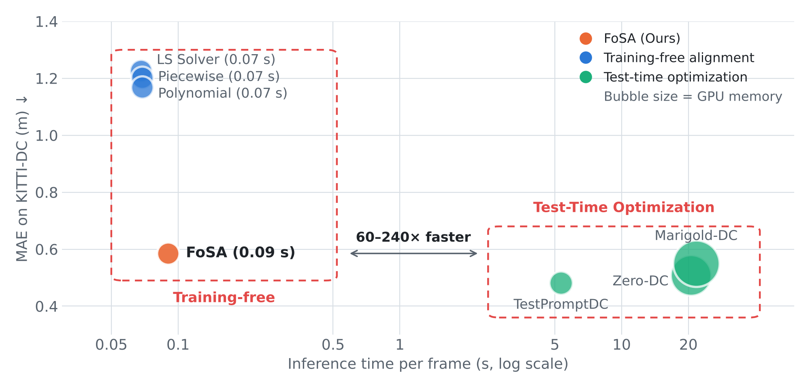
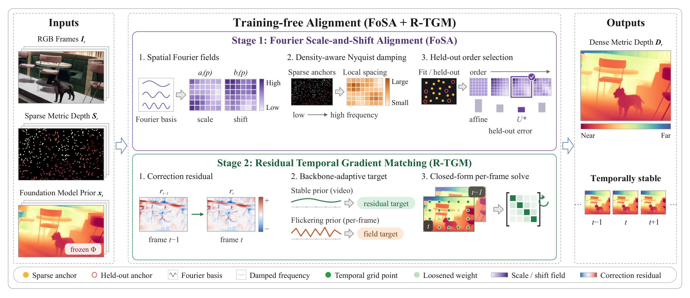
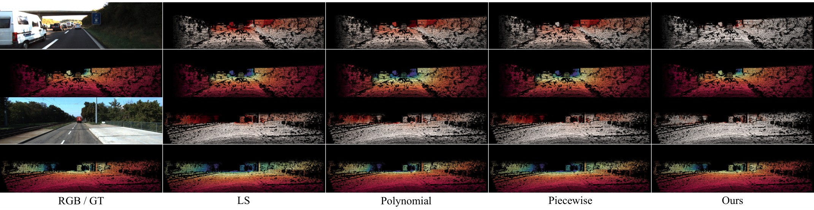

<div align="center">
<h1 style="border-bottom: none; margin-bottom: 0px">FoSA: Fast Video Depth Completion via Fourier Scale-and-Shift Alignment</h1>

[**Myungjun Yun**](https://github.com/YUNMYUNGJUN) · [**Jin-Hwi Park**](https://www.csilab.cau.ac.kr/home)<sup>&dagger;</sup>

[CSILab](https://www.csilab.cau.ac.kr/home),  [Chung-Ang University](https://www.cau.ac.kr)

&dagger;Corresponding author


<a href="LICENSE"></a>

</div>

This work presents **FoSA**, a training-free method that turns the prediction of a frozen depth
foundation model into accurate, temporally stable metric video depth using sparse range
measurements. Each frame is aligned by one closed-form linear solve, with no backpropagation:

- 〰️ **Fourier scale-and-shift fields** replace the global affine fit, so the correction can vary across the image.
- 📡 **Density-aware damping** attenuates each frequency by the local spacing of the measurements, so the degrees of freedom follow their Nyquist limit without manual tuning.
- 🎞️ **Residual Temporal Gradient Matching (R-TGM)** regularizes the correction residual over time, keeping the backbone's own temporal behavior without optical flow or camera pose.

🏆 With a UniDepth V2 backbone, FoSA reduces the MAE of the least-squares fit by 27–59% on NYUv2,
KITTI-DC, DDAD, and DyDToF. It also outperforms test-time adaptation methods on DDAD and DyDToF while
running 60–240× faster than them (0.09 s per frame, backbone included).

<p align="center">
  <picture>
    <source media="(prefers-color-scheme: dark)" srcset="assets/fosa-teaser-dark.png">
    
  </picture>
</p>
<p align="center">
  
</p>

## 📰 News

- **05-11-2026:** 🚀 Project page and foundation-model setup released. Code coming soon.

## 🧩 Supported Foundation Models

FoSA aligns the output of a frozen foundation model, so the same alignment runs on single-image and
video backbones.

| 🗃️ Foundation model | 🎞️ Input | 🐍 conda env | 🔗 Official code |
| :--- | :---: | :---: | :--- |
| UniDepth V2 | Single image | `fosa-unidepth` | [lpiccinelli-eth/UniDepth](https://github.com/lpiccinelli-eth/UniDepth) |
| Video Depth Anything | Video | `fosa-vda` | [DepthAnything/Video-Depth-Anything](https://github.com/DepthAnything/Video-Depth-Anything) |
| DVD | Video | `fosa-dvd` | [EnVision-Research/DVD](https://github.com/EnVision-Research/DVD) |
| Depth Anything 3 | Single image | `fosa-da3` | [ByteDance-Seed/Depth-Anything-3](https://github.com/ByteDance-Seed/Depth-Anything-3) |

## 🚀 Quick Start

### 📦 Setup

Each foundation model requires its own conda environment due to dependency conflicts (torch,
xformers, and CUDA builds differ). Install [Anaconda or Miniconda](https://docs.anaconda.com/miniconda/) first.

```bash
git clone https://github.com/YUNMYUNGJUN/FoSA.git
cd FoSA

bash scripts/setup_env.sh all         # set up all four foundation models
# Or set up individual foundation models
# bash scripts/setup_env.sh unidepth  # set up UniDepth V2 env
# bash scripts/setup_env.sh vda       # set up Video Depth Anything env
# bash scripts/setup_env.sh dvd       # set up DVD env
# bash scripts/setup_env.sh da3       # set up Depth Anything 3 env
```

Each command does the following:

1. Clones the model's official repository into `third_party/` at a pinned commit.
2. Creates a conda environment.
3. Installs the model following its official instructions.
4. Downloads the checkpoints that are not fetched automatically (Video Depth Anything, DVD).
   UniDepth V2 and Depth Anything 3 load their weights from Hugging Face on first use.

After setup, activate the corresponding environment:

```bash
conda activate fosa-unidepth  # for UniDepth V2
conda activate fosa-vda       # for Video Depth Anything
conda activate fosa-dvd       # for DVD
conda activate fosa-da3       # for Depth Anything 3
```

### 💻 Usage

Coming with the code release.

<!--
TODO(server): Replace with the real commands in the CAPA style: one bash block with a comment per
command (e.g., align a single clip, process a directory, evaluate RMSE/MAE/TEPE), each run inside
one of the conda environments above. Every command must actually run against this repository.
-->

## 📊 Results

UniDepth V2 backbone for every sparse depth alignment method. **TTA**: test-time adaptation of the
backbone. **Align**: sparse depth alignment of a frozen backbone's output. Metrics are in meters,
and **bold** marks the best value in each column.

<div align="center">

<table>
<thead>
<tr><th rowspan="2" align="left"><sub>Method</sub></th><th rowspan="2" align="left"><sub>Type</sub></th><th colspan="2"><sub>NYUv2</sub></th><th colspan="2"><sub>KITTI-DC</sub></th><th colspan="2"><sub>DDAD</sub></th><th colspan="2"><sub>DyDToF</sub></th></tr>
<tr><th><sub>RMSE</sub></th><th><sub>MAE</sub></th><th><sub>RMSE</sub></th><th><sub>MAE</sub></th><th><sub>RMSE</sub></th><th><sub>MAE</sub></th><th><sub>RMSE</sub></th><th><sub>MAE</sub></th></tr>
</thead>
<tbody>
<tr><td align="left"><sub>Zero-DC</sub></td><td align="left"><sub>TTA</sub></td><td align="center"><sub>0.152</sub></td><td align="center"><sub>0.097</sub></td><td align="center"><sub>1.515</sub></td><td align="center"><sub>0.509</sub></td><td align="center"><sub>7.163</sub></td><td align="center"><sub>3.621</sub></td><td align="center"><sub>3.399</sub></td><td align="center"><sub>2.038</sub></td></tr>
<tr><td align="left"><sub>Marigold-DC</sub></td><td align="left"><sub>TTA</sub></td><td align="center"><sub>0.135</sub></td><td align="center"><sub><b>0.053</b></sub></td><td align="center"><sub>1.483</sub></td><td align="center"><sub>0.550</sub></td><td align="center"><sub>6.401</sub></td><td align="center"><sub>2.708</sub></td><td align="center"><sub>2.662</sub></td><td align="center"><sub>1.094</sub></td></tr>
<tr><td align="left"><sub>TestPromptDC</sub></td><td align="left"><sub>TTA</sub></td><td align="center"><sub><b>0.128</b></sub></td><td align="center"><sub>0.054</sub></td><td align="center"><sub><b>1.480</b></sub></td><td align="center"><sub><b>0.482</b></sub></td><td align="center"><sub>5.652</sub></td><td align="center"><sub>1.963</sub></td><td align="center"><sub>2.311</sub></td><td align="center"><sub>0.927</sub></td></tr>
<tr><td align="left"><sub>LS Solver</sub></td><td align="left"><sub>Align</sub></td><td align="center"><sub>0.175</sub></td><td align="center"><sub>0.088</sub></td><td align="center"><sub>2.321</sub></td><td align="center"><sub>1.227</sub></td><td align="center"><sub>6.316</sub></td><td align="center"><sub>3.683</sub></td><td align="center"><sub>2.638</sub></td><td align="center"><sub>1.707</sub></td></tr>
<tr><td align="left"><sub>Polynomial</sub></td><td align="left"><sub>Align</sub></td><td align="center"><sub>0.169</sub></td><td align="center"><sub>0.084</sub></td><td align="center"><sub>2.255</sub></td><td align="center"><sub>1.168</sub></td><td align="center"><sub>5.183</sub></td><td align="center"><sub>2.672</sub></td><td align="center"><sub>2.337</sub></td><td align="center"><sub>1.306</sub></td></tr>
<tr><td align="left"><sub>Piecewise</sub></td><td align="left"><sub>Align</sub></td><td align="center"><sub>0.172</sub></td><td align="center"><sub>0.086</sub></td><td align="center"><sub>2.314</sub></td><td align="center"><sub>1.203</sub></td><td align="center"><sub>5.792</sub></td><td align="center"><sub>3.111</sub></td><td align="center"><sub>2.466</sub></td><td align="center"><sub>1.438</sub></td></tr>
<tr><td align="left"><sub><b>FoSA (Ours)</b></sub></td><td align="left"><sub>Align</sub></td><td align="center"><sub>0.148</sub></td><td align="center"><sub>0.064</sub></td><td align="center"><sub>1.749</sub></td><td align="center"><sub>0.585</sub></td><td align="center"><sub><b>4.551</b></sub></td><td align="center"><sub><b>1.527</b></sub></td><td align="center"><sub><b>1.854</b></sub></td><td align="center"><sub><b>0.798</b></sub></td></tr>
</tbody>
</table>

</div>

<p align="center">
  
</p>

For the other backbones (VDA, DVD, DAv3), temporal consistency (TEPE), sparser measurements,
ablation, efficiency, and qualitative results, see [docs/RESULTS.md](docs/RESULTS.md).

## 📚 Useful Documentation

- 🧮 [Method](docs/METHOD.md): the alignment, equation by equation
- 📊 [Results](docs/RESULTS.md): all tables and figures of the paper

## 📄 License

Copyright © 2026 YUNMYUNGJUN.

The FoSA source code is released under the [MIT License](LICENSE).

## 🙏 Acknowledgments

This research was supported by the Chung-Ang University Research Grants in 2025 and the MSIT
(Ministry of Science and ICT), Korea, under the Graduate School of Virtual Convergence support
program (RS-2024-00418847) supervised by the IITP (Institute for Information & Communications
Technology Planning & Evaluation).
