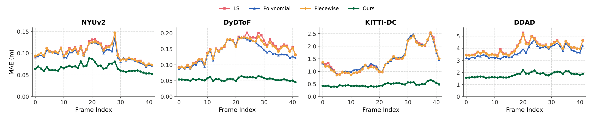
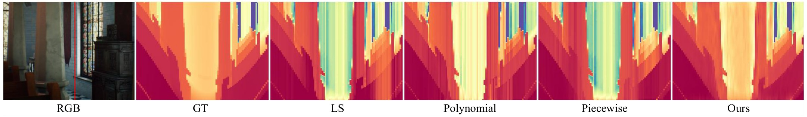
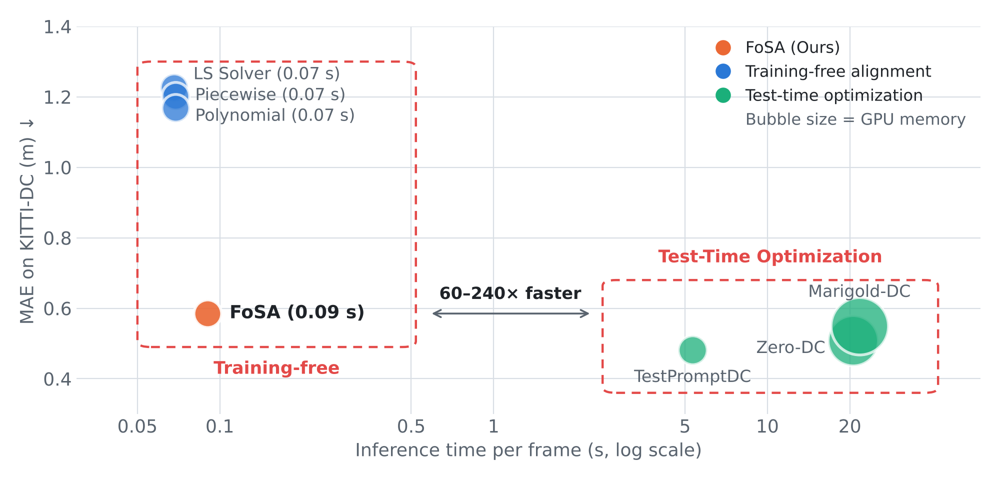
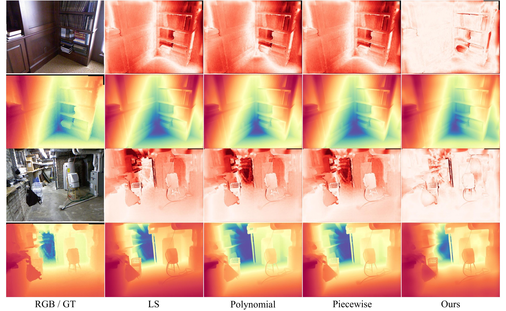
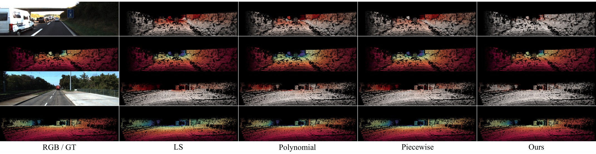

# 📊 FoSA results

All numbers on this page are reported in the paper.

## Contents

1. [Benchmarks and protocol](#-benchmarks-and-protocol)
2. [Comparison with depth completion methods](#-comparison-with-depth-completion-methods)
3. [Generalization across backbones](#-generalization-across-backbones)
4. [Temporal consistency](#-temporal-consistency)
5. [Robustness to sparser measurements](#-robustness-to-sparser-measurements)
6. [Ablation](#-ablation)
7. [Efficiency](#-efficiency)
8. [Qualitative results](#-qualitative-results)

## 📋 Benchmarks and protocol

| Benchmark | Paper |
| :--- | :--- |
| NYUv2 | [Indoor Segmentation and Support Inference from RGBD Images](https://cs.nyu.edu/~fergus/datasets/nyu_depth_v2.html) (ECCV 2012) |
| VOID | [Unsupervised Depth Completion from Visual Inertial Odometry](https://github.com/alexklwong/void-dataset) (RA-L 2020) |
| DyDToF | [Consistent Direct Time-of-Flight Video Depth Super-Resolution](https://github.com/facebookresearch/DVSR) (CVPR 2023) |
| KITTI-DC | [Are We Ready for Autonomous Driving? The KITTI Vision Benchmark Suite](https://www.cvlibs.net/datasets/kitti/eval_depth.php?benchmark=depth_completion) (CVPR 2012) |
| DDAD | [3D Packing for Self-Supervised Monocular Depth Estimation](https://github.com/TRI-ML/DDAD) (CVPR 2020) |

All sparse depth alignment methods (LS Solver, Polynomial, Piecewise, Ours) are applied to the same
backbone predictions and the same sparse measurements.

- **RMSE** and **MAE** pool the valid pixels of all frames.
- **TEPE** measures the frame-to-frame change of the aligned depth after warping with GMFlow optical flow.
- All metrics are in meters, and lower is better.
- The ground truth of KITTI-DC and DDAD is clipped at 80 m.
- **Bold** is the best and <ins>underlined</ins> the second best in each column (or row).

## 🏆 Comparison with depth completion methods

UniDepth V2 backbone for every sparse depth alignment method. **TTA**: test-time adaptation of the
backbone. **Align**: sparse depth alignment of a frozen backbone's output.

<table>
<thead>
<tr><th rowspan="2" align="left">Method</th><th rowspan="2" align="left">Type</th><th colspan="2">NYUv2</th><th colspan="2">KITTI-DC</th><th colspan="2">DDAD</th><th colspan="2">DyDToF</th></tr>
<tr><th>RMSE</th><th>MAE</th><th>RMSE</th><th>MAE</th><th>RMSE</th><th>MAE</th><th>RMSE</th><th>MAE</th></tr>
</thead>
<tbody>
<tr><td align="left">Zero-DC</td><td align="left">TTA</td><td align="center">0.152</td><td align="center">0.097</td><td align="center">1.515</td><td align="center"><ins>0.509</ins></td><td align="center">7.163</td><td align="center">3.621</td><td align="center">3.399</td><td align="center">2.038</td></tr>
<tr><td align="left">Marigold-DC</td><td align="left">TTA</td><td align="center"><ins>0.135</ins></td><td align="center"><b>0.053</b></td><td align="center"><ins>1.483</ins></td><td align="center">0.550</td><td align="center">6.401</td><td align="center">2.708</td><td align="center">2.662</td><td align="center">1.094</td></tr>
<tr><td align="left">TestPromptDC</td><td align="left">TTA</td><td align="center"><b>0.128</b></td><td align="center"><ins>0.054</ins></td><td align="center"><b>1.480</b></td><td align="center"><b>0.482</b></td><td align="center">5.652</td><td align="center"><ins>1.963</ins></td><td align="center"><ins>2.311</ins></td><td align="center"><ins>0.927</ins></td></tr>
<tr><td align="left">LS Solver</td><td align="left">Align</td><td align="center">0.175</td><td align="center">0.088</td><td align="center">2.321</td><td align="center">1.227</td><td align="center">6.316</td><td align="center">3.683</td><td align="center">2.638</td><td align="center">1.707</td></tr>
<tr><td align="left">Polynomial</td><td align="left">Align</td><td align="center">0.169</td><td align="center">0.084</td><td align="center">2.255</td><td align="center">1.168</td><td align="center"><ins>5.183</ins></td><td align="center">2.672</td><td align="center">2.337</td><td align="center">1.306</td></tr>
<tr><td align="left">Piecewise</td><td align="left">Align</td><td align="center">0.172</td><td align="center">0.086</td><td align="center">2.314</td><td align="center">1.203</td><td align="center">5.792</td><td align="center">3.111</td><td align="center">2.466</td><td align="center">1.438</td></tr>
<tr><td align="left"><b>FoSA (Ours)</b></td><td align="left">Align</td><td align="center">0.148</td><td align="center">0.064</td><td align="center">1.749</td><td align="center">0.585</td><td align="center"><b>4.551</b></td><td align="center"><b>1.527</b></td><td align="center"><b>1.854</b></td><td align="center"><b>0.798</b></td></tr>
</tbody>
</table>

  

Per-frame MAE of the sparse depth alignment methods over 42 frames with a UniDepth V2 backbone.
FoSA attains the lowest MAE in every frame, and its error varies less across frames.

## 🧩 Generalization across backbones

FoSA attains the lowest MAE in all 15 backbone–dataset configurations and the lowest RMSE in 13 of
them. It also improves on the LS solver in both metrics in every configuration.

**VDA backbone**

| Dataset | LS RMSE | LS MAE | Poly. RMSE | Poly. MAE | Piece. RMSE | Piece. MAE | **Ours** RMSE | **Ours** MAE |
| :--- | :---: | :---: | :---: | :---: | :---: | :---: | :---: | :---: |
| NYUv2 | 0.279 | 0.161 | <ins>0.237</ins> | <ins>0.135</ins> | 0.271 | 0.162 | **0.171** | **0.079** |
| VOID | 0.638 | 0.219 | 0.969 | 0.253 | <ins>0.636</ins> | <ins>0.210</ins> | **0.629** | **0.185** |
| DyDToF | 2.934 | 2.011 | 2.475 | 1.369 | **2.312** | <ins>1.286</ins> | <ins>2.336</ins> | **0.904** |
| KITTI-DC | 3.657 | 2.063 | 3.911 | 2.277 | <ins>3.468</ins> | <ins>1.767</ins> | **2.243** | **0.752** |
| DDAD | 11.511 | 7.734 | 17.441 | 12.585 | <ins>8.434</ins> | <ins>5.160</ins> | **5.357** | **1.915** |

**DVD backbone**

| Dataset | LS RMSE | LS MAE | Poly. RMSE | Poly. MAE | Piece. RMSE | Piece. MAE | **Ours** RMSE | **Ours** MAE |
| :--- | :---: | :---: | :---: | :---: | :---: | :---: | :---: | :---: |
| NYUv2 | <ins>0.299</ins> | 0.188 | 0.315 | <ins>0.161</ins> | 0.331 | 0.173 | **0.188** | **0.093** |
| VOID | 0.696 | 0.246 | 1.362 | 0.351 | <ins>0.694</ins> | <ins>0.241</ins> | **0.679** | **0.207** |
| DyDToF | 3.714 | 1.912 | <ins>3.287</ins> | <ins>1.600</ins> | 3.352 | 1.630 | **2.632** | **1.113** |
| KITTI-DC | 4.087 | 1.789 | <ins>3.419</ins> | <ins>1.549</ins> | 3.444 | 1.558 | **2.245** | **0.756** |
| DDAD | 8.492 | 4.750 | 6.505 | 3.713 | <ins>6.221</ins> | <ins>3.533</ins> | **4.957** | **1.825** |

**DAv3 backbone**

| Dataset | LS RMSE | LS MAE | Poly. RMSE | Poly. MAE | Piece. RMSE | Piece. MAE | **Ours** RMSE | **Ours** MAE |
| :--- | :---: | :---: | :---: | :---: | :---: | :---: | :---: | :---: |
| NYUv2 | 0.225 | 0.125 | <ins>0.218</ins> | <ins>0.115</ins> | 0.219 | 0.119 | **0.177** | **0.076** |
| VOID | <ins>0.626</ins> | 0.204 | 1.103 | 0.294 | 0.628 | <ins>0.197</ins> | **0.624** | **0.179** |
| DyDToF | 3.002 | 2.015 | **2.690** | <ins>1.608</ins> | <ins>2.849</ins> | 1.757 | 2.914 | **1.148** |
| KITTI-DC | 3.181 | 1.721 | <ins>2.881</ins> | <ins>1.481</ins> | 3.112 | 1.603 | **1.998** | **0.605** |
| DDAD | 7.885 | 4.805 | <ins>5.805</ins> | <ins>3.251</ins> | 6.509 | 3.737 | **5.217** | **1.709** |

## 🎬 Temporal consistency

TEPE on NYUv2 and KITTI-DC across backbones:

| Dataset | Backbone | LS | Polynomial | Piecewise | **Ours** |
| :--- | :--- | :---: | :---: | :---: | :---: |
| **NYUv2** | UniDepth V2 | <ins>0.075</ins> | 0.076 | 0.078 | **0.071** |
|  | VDA | <ins>0.088</ins> | 0.091 | 0.111 | **0.083** |
|  | DVD | 0.106 | <ins>0.105</ins> | 0.112 | **0.094** |
|  | DAv3 | <ins>0.086</ins> | 0.088 | 0.090 | **0.084** |
| **KITTI-DC** | UniDepth V2 | <ins>0.517</ins> | 0.530 | 0.546 | **0.432** |
|  | VDA | <ins>0.517</ins> | 0.958 | 0.543 | **0.464** |
|  | DVD | 0.722 | 0.686 | <ins>0.614</ins> | **0.558** |
|  | DAv3 | <ins>0.600</ins> | 0.602 | 0.639 | **0.437** |

TEPE on DyDToF against test-time adaptation:

| Method | Backbone | TEPE |
| :--- | :--- | :---: |
| Zero-DC | Marigold | 1.490 |
| Marigold-DC | Marigold | 1.455 |
| TestPromptDC | UniDepth V2 | 1.070 |
| **FoSA (Ours)** | UniDepth V2 | <ins>0.812</ins> |
| **FoSA (Ours)** | VDA | **0.789** |

  

Temporal slices on a DyDToF scene (UniDepth V2). Each slice stacks the depth along the red line
over time. The baselines show vertical streaks where the depth jumps between frames. FoSA instead
follows the smooth bands of the ground truth.

## 📉 Robustness to sparser measurements

UniDepth V2 backbone, with each benchmark at a lower measurement density. The same hyperparameters
are used at every density.

| Method | KITTI-DC RMSE | MAE | DyDToF RMSE | MAE | NYUv2 RMSE | MAE | VOID RMSE | MAE | DDAD RMSE | MAE |
| :--- | :---: | :---: | :---: | :---: | :---: | :---: | :---: | :---: | :---: | :---: |
| UniDepth V2 | 2.698 | 1.380 | 5.018 | 3.298 | 0.219 | 0.140 | 0.767 | 0.313 | 6.818 | 3.463 |
| + LS | <ins>2.371</ins> | 1.291 | 2.705 | 1.727 | <ins>0.179</ins> | <ins>0.093</ins> | <ins>0.675</ins> | 0.204 | 6.354 | 3.695 |
| + Poly. | 2.571 | <ins>1.273</ins> | 3.389 | <ins>1.512</ins> | 0.395 | 0.122 | 1.228 | 0.300 | <ins>5.342</ins> | <ins>2.697</ins> |
| + Piece. | 2.398 | 1.280 | **2.642** | **1.494** | 0.183 | 0.097 | <ins>0.675</ins> | <ins>0.201</ins> | 5.696 | 2.944 |
| **+ Ours** | **1.958** | **0.692** | <ins>2.677</ins> | 1.713 | **0.178** | **0.092** | **0.669** | **0.187** | **4.816** | **1.691** |

On the sparsest DyDToF and NYUv2 settings, too few anchors are held out to score a spatial
correction. FoSA then falls back to the global fit and still regularizes it over time with R-TGM.

## 🔬 Ablation

NYUv2, DVD backbone. Components are added one at a time.

| Configuration | RMSE | MAE | TEPE |
| :--- | :---: | :---: | :---: |
| Baseline (LS Solver) | 0.299 | 0.188 | 0.106 |
| + Robust IRLS | 0.285 | 0.173 | 0.099 |
| + Monotonic projection | 0.285 | 0.173 | 0.099 |
| + Spatial field | 0.199 | 0.099 | 0.108 |
| + Bandwidth (density-aware damping) | **0.187** | **0.092** | <ins>0.095</ins> |
| + Auto order | <ins>0.188</ins> | <ins>0.093</ins> | 0.096 |
| + R-TGM (**Full**) | <ins>0.188</ins> | <ins>0.093</ins> | **0.094** |

## ⚡ Efficiency

KITTI-DC, UniDepth V2 backbone. Memory and time include the backbone. The number in parentheses is
the memory used by the alignment step alone.

| Method | Required memory (MB) | Inference speed (s/image) |
| :--- | :---: | :---: |
| Zero-DC | 8727 | 20.56 |
| Marigold-DC | 11372 | 21.67 |
| TestPromptDC | 2885 | 5.33 |
| LS Solver | 2636.7 (9.3) | 0.068 |
| Polynomial | 2637.6 (15.3) | 0.069 |
| Piecewise | 2637.6 (16.7) | 0.069 |
| **FoSA (Ours)** | 2637.6 (20.0) | 0.090 |

  <picture>
    <source media="(prefers-color-scheme: dark)" srcset="../assets/fosa-teaser-dark.png">
    
  </picture>

FoSA runs about 60–240× faster than the test-time adaptation methods. It processes more than 11
frames per second including the backbone, because each reweighting step is one small linear solve
with no backpropagation through the backbone.

## 🎨 Qualitative results

  

NYUv2, DVD backbone. In each scene, the top row shows the absolute error (white is low, dark red is
high) and the bottom row shows the aligned depth.

  

KITTI-DC, DVD backbone, shown at pixels with valid ground truth.
